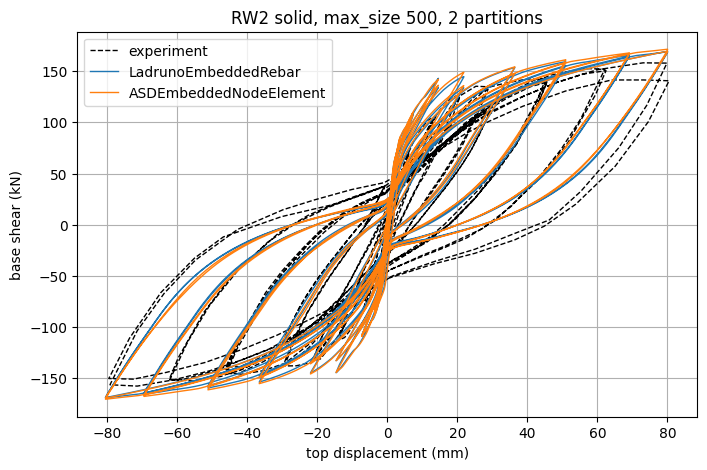

# RW2_Wallace / context

Trazabilidad y documentación de respaldo para el cuaderno `rw2_solid_ladruno_embedment.ipynb`:

| cuaderno | modelo | referencia |
|---|---|---|
| `rw2_solid_ladruno_embedment.ipynb` | hexaedros (`LadrunoBrick`) + barras discretas unidas con `LadrunoEmbeddedRebar` (adherencia perfecta), 2 particiones | PEER 2006/07 (geometría, barras, materiales) |

Unidades generales: N, mm, MPa a menos que se indique lo contrario.

## Archivos

| archivo | contenido |
|---|---|
| [calibration_solid.md](calibration_solid.md) | Calibración con tamaño de malla de 200 mm del modelo sólido Ladruno: ejecuciones, cambios, métricas y configuración seleccionada |
| [sources.md](sources.md) | Archivos fuente utilizados, rutas, contenidos, unidades y correspondencia de páginas del PDF |
| [geometry_reinforcement.md](geometry_reinforcement.md) | Geometría del espécimen, disposición de armaduras de la Fig. 7.3a, coordenadas de barras en `rw2_solid_ladruno_embedment` y verificación de cuantías |
| [materials.md](materials.md) | Valores de materiales del artículo (Tablas 7.1-7.2), valores base de STKO y parámetros utilizados en el cuaderno sólido |
| [stko_deck.md](stko_deck.md) | Auditoría de las líneas del deck base STKO del cual se derivaron los parámetros del preajuste 9P |
| [experimental_data.md](experimental_data.md) | Archivo de datos de ensayo, unidades y factores de conversión |
| [assumptions.md](assumptions.md) | Supuestos de modelación y puntos abiertos |
| `figs/` | Páginas del reporte PDF renderizadas como imágenes PNG (evidencia) |
| `scripts/` | Auditor del deck STKO, recuperación de parámetros 9P y sus salidas guardadas |

## Valor -> fuente, `rw2_solid_ladruno_embedment.ipynb`

| entrada | valor | fuente |
|---|---|---|
| `lw`, `hw`, `tw` | 1220, 3660, 102 | PEER 607 sec. 7.1.1 (págs. 125-126 del pdf), Fig. 7.1, 7.3a |
| `lbe` | 200 | Ancho de franja de borde; las barras se extienden de 19 a 172 mm del extremo (Fig. 7.3a) |
| `h_conf` | 1220 | "elementos de borde confinados detallados ... a lo largo de los 1.22 m inferiores (lw)", sec. 7.1.1 (pág. 126 del pdf) |
| `base_overhang`, `base_depth` | 500, 500 | Geometría base equivalente. Pedestal real: 1930 x 690 (Fig. 7.2) |
| `base_e` | 28198 x 500 / 102 | Módulo elástico base escalado al espesor 102 mm para rigidez equivalente en el plano |
| `ec` | 31030 | Tabla 7.1 / 7.2 (pág. 142 del pdf) |
| `ft` | 2.03 | Tabla 7.1 |
| `fcp_unconf`, `ecp_unconf` | 42.8, 0.0021 | Tabla 7.2, alma de RW2 (no confinado); sec. 7.1.2 indica media de 42.8 MPa en la base |
| `fcp_conf`, `ecp_conf` | 47.6, 0.0033 | Tabla 7.2, borde de RW2 (confinado) |
| `fc0`, `fcr`, `gt`, `gc`, `pscale_*` | 10, 10, 0.1, 36, 0.3 | No reportados en el artículo; adoptados del preajuste STKO 9P (ver `scripts/recover_9p_output.txt`) |
| `db3`, `db2`, `dbw` | 9.53, 6.35, 4.76 | sec. 7.1.1 y Fig. 7.3a |
| `fy3` | 434 | Tabla 7.1 (#3, barra desnuda) |
| `fy2` | 448 | Tabla 7.1 (#2) y sec. 7.1.2 |
| `fyw` | 448 | sec. 7.1.2 (alambre recocido a ~448 MPa) |
| `es`, `b3`, `b2` | 200000, 0.02, 0.02 | Tabla 7.1 |
| `bw` | 0.005 | Supuesto: "región de endurecimiento por deformación ... relativamente plana" (sec. 7.1.2) |
| R0, cR1, cR2 | 20, 0.925, 0.0015 | sec. 7.2.2.1 (pág. 141 del pdf): R0 20, a1 18.5, a2 0.0015 -> cR1 = a1 / R0 |
| `edge`, `be_step`, `web_step`, `hoop_step` | 19, 51, 191, 76 | Fig. 7.3a (pág. 127 del pdf) |
| `anchor_depth` | 450 | Supuesto: barras ancladas en el pedestal (sec. 7.1.1); gancho no modelado explícitamente |
| `k_perfect` | 1e8 | Supuesto: penalización de adherencia perfecta de `LadrunoEmbeddedRebar` |
| `bar_refine` | 4 | Regla de modelación: discretización de barras 4 veces más fina que el hormigón (segmento = max_size / 4) |
| `p_axial` | 0.07 x 1220 x 102 x 42.8 = 372.8 kN | PEER 607 sec. 6.1 (pág. 100 del pdf) "carga axial de aproximadamente 0.07 Ag f'c" |
| `gamma_c` | 2.4e-9 x 9810 | Peso propio del hormigón del muro |

## Software utilizado por el cuaderno sólido

| ítem | valor |
|---|---|
| apeGmsh | rama `feat/plate-rebar-plate-from-plane-stress`, commit `f8eae4cc` (emisión particionada de restricciones de barras embebidas) sobre `f2516343` |
| solver | `OpenSeesMP` compilado desde el fork Ladruno rama `ladruno-sync` |
| particiones | `nparts = 2`, `mpirun -np 2`; cada unión opera en el rango de su hexaedro anfitrión y el nodo de la barra se declara como nodo fantasma cuando es requerido |

## Primeras ejecuciones (max_size 500, 2 particiones)

| modelo | corte basal máximo (kN) | vs ensayo experimental |
|---|---|---|
| `rw2_solid_ladruno_embedment` (LadrunoEmbeddedRebar) | -169.2 / +169.5 | +7.4 % / +7.1 % |
| ensayo experimental | -157.6 / +158.2 | - |

Ambas fases de carga: 10 incrementos de gravedad + 5000 incrementos cíclicos, sin pasos fallidos, aproximadamente 9 minutos de ejecución.

