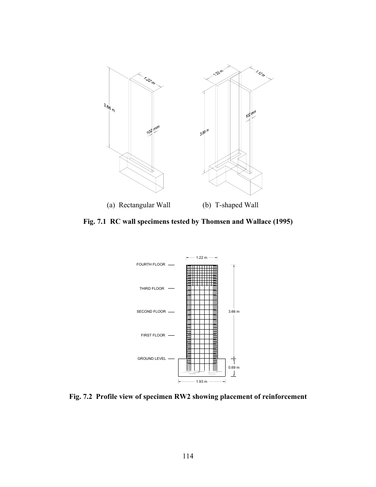
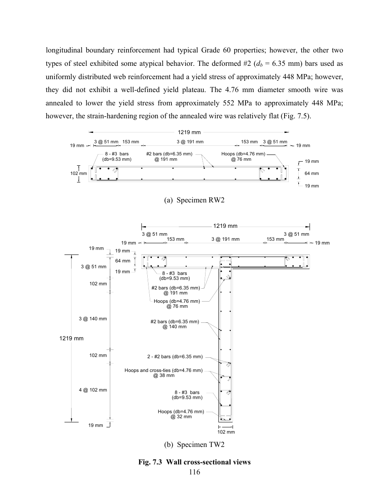

# Geometría y armadura

## Espécimen (PEER 2006/07 sec. 7.1.1, Fig. 7.1-7.3a)

| ítem | valor | evidencia |
|---|---|---|
| muro | 1219 mm (1.22 m) de largo, 3.66 m de alto, 102 mm de espesor | sec. 6.1 (pág. 100 del pdf), sec. 7.1.1 (pág. 125 del pdf), Fig. 7.3a |
| pedestal | 1.93 m de largo, 0.69 m de profundidad | Fig. 7.2 (pág. 125 del pdf) |
| zona de borde confinada | 1.22 m inferiores (= lw) | sec. 7.1.1 (pág. 126 del pdf) |
| anclaje de barras verticales | ganchos a 90 grados dentro del pedestal | sec. 7.1.1 (pág. 126 del pdf), Fig. 7.2 |

## Disposición de armaduras, Fig. 7.3a (pág. 127 del pdf)

Dirección longitudinal: `19 | 3 @ 51 | 153 | 3 @ 191 | 153 | 3 @ 51 | 19` (la suma da 1223 mm frente a 1219 mm totales, debido a un redondeo de 4 mm en el dibujo). Dirección del espesor: `19 | 64 | 19`.

| barras | dimensión | disposición |
|---|---|---|
| longitudinal de borde | 8 #3 (db 9.53) por extremo | 4 a lo largo de la longitud (3 @ 51) x 2 capas (separadas 64 mm) |
| alma vertical | #2 (db 6.35) | dos mallas, 3 @ 191 entre los grupos de borde |
| alma horizontal | #2 (db 6.35) @ 191 | dos mallas |
| estribos | alambre liso de 4.76 mm @ 76 | estribo cerrado alrededor de cada grupo de 8 barras de borde (más traba con gancho, Fig. 7.3a) |

## Barras en `rw2_solid_ladruno_embedment.ipynb` (x desde el extremo izquierdo del muro, y desde el plano medio, z desde la base)

| barras | cantidad | x | y | z |
|---|---|---|---|---|
| borde #3 | 2 x 8 = 16 | 19, 70, 121, 172, 1048, 1099, 1150, 1201 | +-32 | -450 a 3641 |
| alma vertical #2 | 8 | 323.5, 514.5, 705.5, 896.5 (3 @ 191 centradas en lw / 2 = 610) | +-32 | -450 a 3641 |
| alma horizontal #2 | 2 x 19 = 38 | 19 a 1201 | +-32 | 191, 382, ..., 3629 |
| estribos, alambre 4.76 | 2 x 16 = 32 | rectángulo 11.9 a 179.1 (y simétrico) | +-39.1 | 38, 114, ..., 1178 |

- Las barras del alma en 3 @ 191 se ubican centradas en el muro, dejando un espacio libre de 151.5 mm hacia el grupo de borde a cada lado (153 mm en el dibujo original).
- El eje del estribo queda desplazado `(9.53 + 4.76) / 2 = 7.1 mm` hacia el exterior respecto a los centros de las barras de borde.
- Las barras de alma horizontales y verticales se modelan en el mismo plano (y = +-32). Al utilizar barras embebidas, no interactúan geométricamente entre sí.
- Las trabas interiores con gancho de cada estribo (Fig. 7.3a) y los ganchos a 90 grados dentro del pedestal no se modelan explícitamente.
- Los estribos por encima de 1220 mm no se modelan (el reporte solo detalla armadura de confinamiento en los 1.22 m inferiores).

## Cuantía de armadura

Cuantía de acero vertical en elementos de borde:
$$\rho_{v,be} = \frac{8 \times 71.33}{200 \times 102} = 2.80\,\%$$
Espesor equivalente de acero por cara para el borde: $4 \times 71.33 / 200 = 1.4266\text{ mm}$.
Espesor equivalente de estribos: una rama por cara ($17.80\text{ mm}^2$) @ $76\text{ mm} \rightarrow 17.80 / 76 = 0.2342\text{ mm}$.
