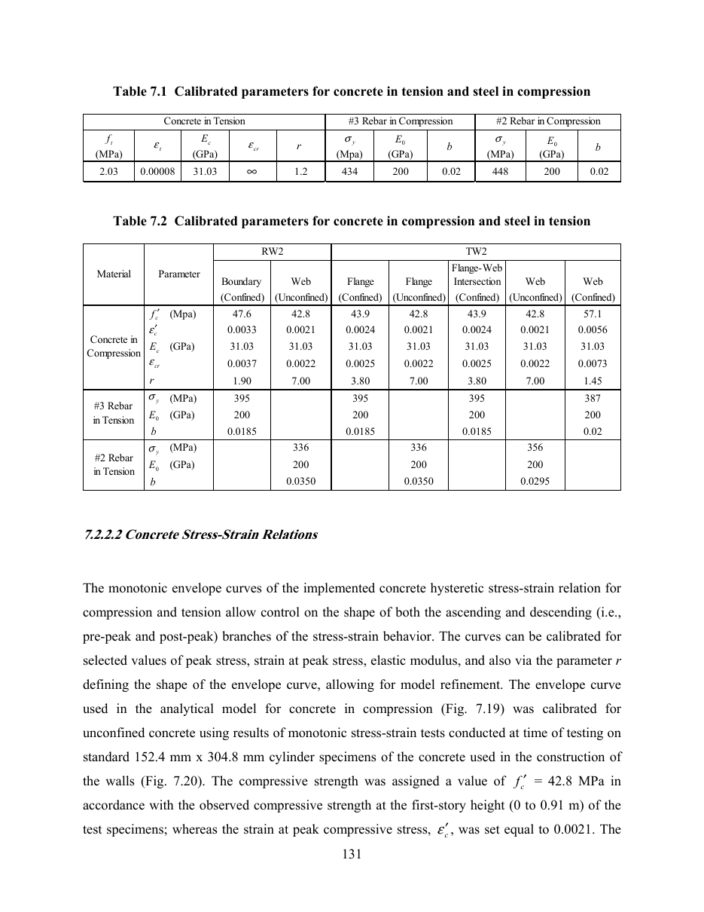

# Materiales

## Valores del artículo (PEER 2006/07)

**Ensayos** (sec. 7.1.2, págs. 126-127 del pdf; curvas en Fig. 7.4-7.5, pág. 128 del pdf):

- Hormigón: nominal de diseño 27.6 MPa; resistencia media a compresión de RW2 en la base (0-0.91 m) de aproximadamente **42.8 MPa**, alcanzando el pico con una deformación unitaria en probeta cilíndrica de ~0.002.
- Barras #3 (db 9.53): acero grado 60 típico (414 MPa nominal).
- Barras #2 (db 6.35): fluencia en torno a **448 MPa**, sin meseta de fluencia definida.
- Alambre de 4.76 mm: recocido desde ~552 a aproximadamente **448 MPa**, con endurecimiento relativamente plano.

**Valores calibrados** (Tabla 7.1 y 7.2, pág. 142 del pdf):

| Tabla 7.1 | ft 2.03 MPa, eps_t 0.00008, Ec 31.03 GPa, eps_cr inf, r 1.2 | #3 en compresión: sigma_y 434, E0 200 GPa, b 0.02 | #2 en compresión: sigma_y 448, E0 200 GPa, b 0.02 |
|---|---|---|---|

| Tabla 7.2, RW2 | borde (confinado) | alma (no confinado) |
|---|---|---|
| f'c (MPa) | 47.6 | 42.8 |
| eps'c | 0.0033 | 0.0021 |
| E (GPa) | 31.03 | 31.03 |
| eps_cr | 0.0037 | 0.0022 |
| r | 1.90 | 7.00 |
| #3 en tracción | sigma_y 395, E0 200 GPa, b 0.0185 | - |
| #2 en tracción | - | sigma_y 336, E0 200 GPa, b 0.0350 |

Los valores en tracción (395, 336 MPa) se encuentran reducidos para representar rigidización por tracción (tension stiffening) en fibras uniaxiales tipo MVLEM (sec. 7.2.2.1, Belarbi & Hsu 1994). Los valores en compresión (434, 448 MPa) corresponden a las propiedades de barra desnuda.
Parámetros cíclicos: R0 = 20, a1 = 18.5, a2 = 0.0015 (sec. 7.2.2.1, pág. 141 del pdf).

## Parámetros base STKO (Concrete 9P)

Valores de referencia recuperados de la calibración STKO (ver `scripts/recover_9p_output.txt`):

| ASDConcrete3D 9P | E | v | ft | fc0 | fcp | fcr | ecp | Gt | Gc | pscale t / c | lch_ref |
|---|---|---|---|---|---|---|---|---|---|---|---|
| Preajuste STKO | 29279 | 0.2 | 0.4 | 10 | 42.8 | 10 | 0.005 | 0.1 | 36 | 0.3 / 0.3 | 7.9242 |

## `rw2_solid_ladruno_embedment.ipynb` (valores adoptados)

| material | modelo | valores | fuente |
|---|---|---|---|
| hormigón no confinado (alma, borde > 1220 mm) | `ASDConcrete3D`, preajuste 9P | E 31030, v 0.2, ft 2.03, fcp 42.8, ecp 0.0021 | Tablas 7.1-7.2 (alma) |
| hormigón confinado (borde, 0-1220 mm) | `ASDConcrete3D`, preajuste 9P | igual al anterior con fcp 47.6, ecp 0.0033 | Tabla 7.2 (borde) |
| ambos hormigones, parámetros 9P adicionales | - | fc0 10, fcr 10, Gt 0.1 N/mm, Gc 36 N/mm, pscale 0.3 / 0.3, IMPL-EX | Preajuste STKO (verificado en `scripts/recover_9p_output.txt`) |
| barras de borde #3 | `Steel02` / `Hysteretic` | fy 434, E 200000, b 0.02, R0 20, cR1 0.925, cR2 0.0015 | Tabla 7.1 (barra desnuda), sec. 7.2.2.1 |
| barras de alma #2 | `Steel02` / `Hysteretic` | fy 448, b 0.02, mismos R0 / cR1 / cR2 | Tabla 7.1, sec. 7.1.2 |
| estribos alambre 4.76 | `Steel02` / `Hysteretic` | fy 448, b 0.005 | sec. 7.1.2; b supuesto |
| bloque de base | elástico | E 28198 x 500 / 102 = 138225, v 0.2 | Módulo base escalado para t = 102 mm |

Por qué se utilizan valores de barra desnuda: el modelo sólido incluye barras discretas embebidas en hormigón con fisuración continua 3D; el efecto de rigidización por tracción se deriva naturalmente de la rama de ablandamiento del hormigón. Utilizar valores reducidos duplicaría dicho efecto.

Correspondencia de parámetros para `Steel02`:
OpenSees formula $R = R_0 (1 - c_{R1} \xi / (c_{R2} + \xi))$; el artículo utiliza $R = R_0 - a_1 \xi / (a_2 + \xi)$, por lo cual $c_{R1} = a_1 / R_0 = 18.5 / 20 = 0.925$ y $c_{R2} = a_2 = 0.0015$.

Verificación de consistencia del hormigón confinado:
$f_{cp} / E = 47.6 / 31030 = 0.00153 < e_{cp} = 0.0033$, y $f_{c0} = 10 < f_{cp}$, cumpliendo los requisitos del preajuste 9P.
