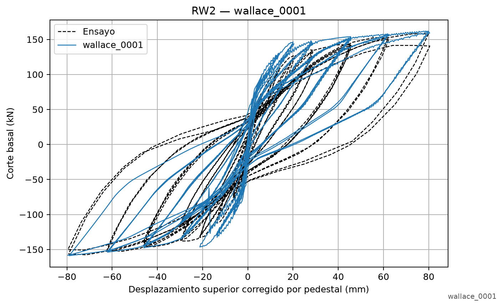
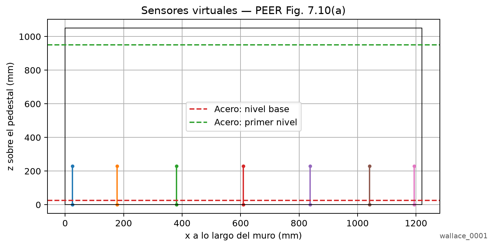
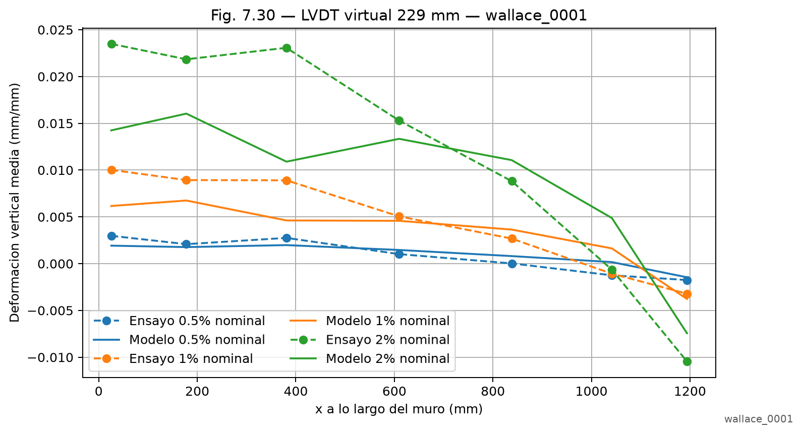
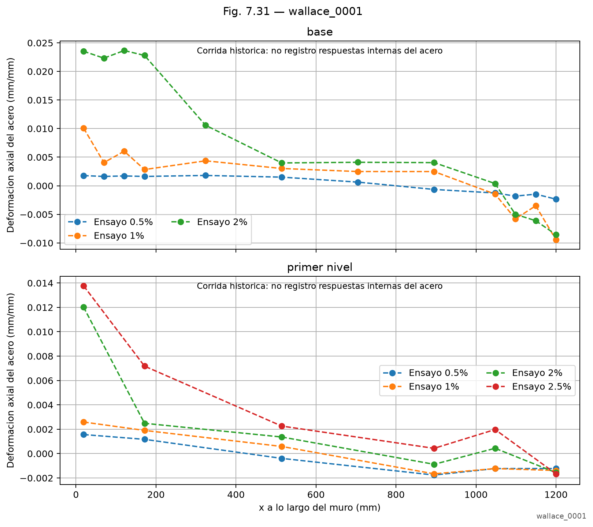
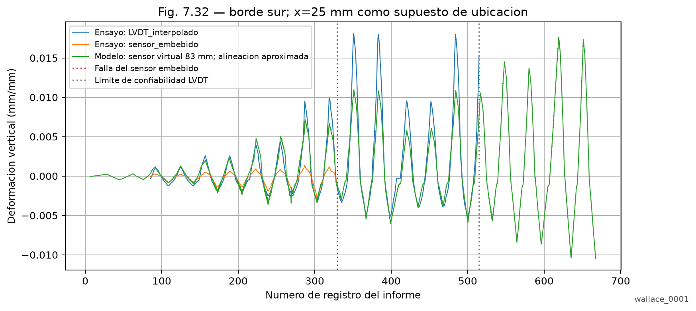
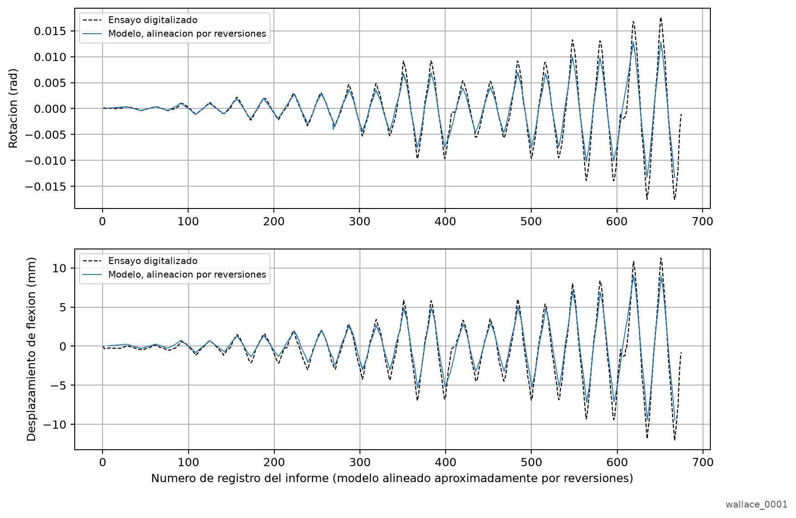
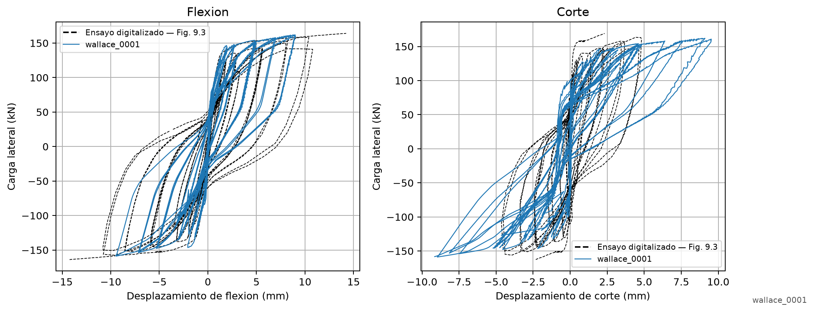
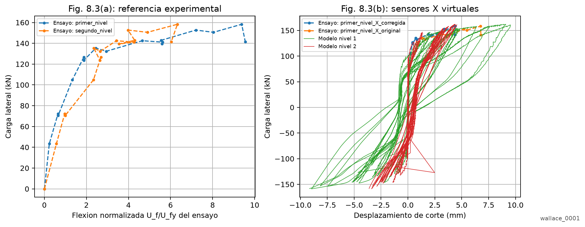
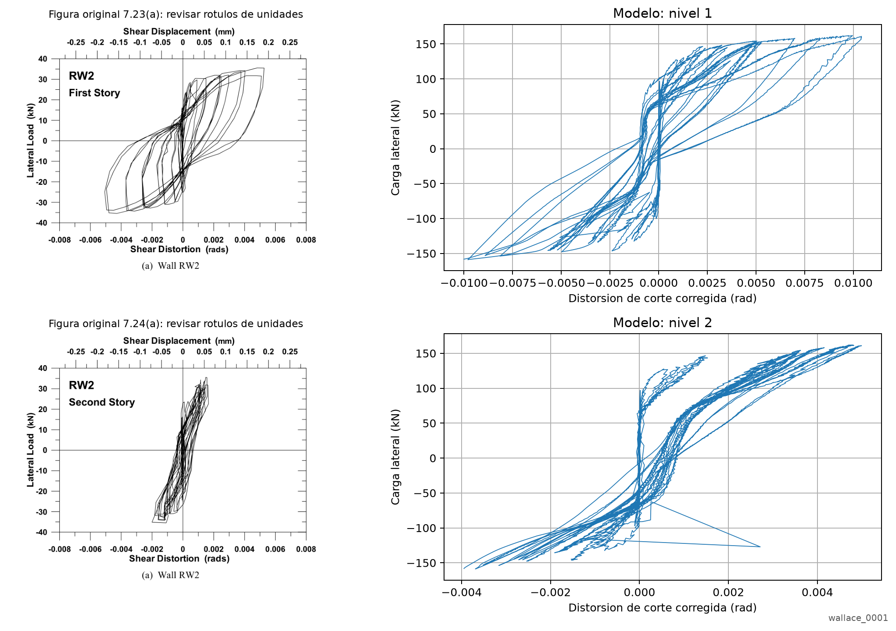
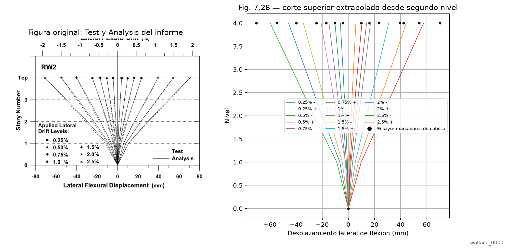

# wallace_0001 — RW2

- Fecha: 2026-11-11T11:44:28-03:00
- Estado: **importada_historica**
- Analisis completo verificado: **False**
- Procedencia de parametros: Solo comandos del Tcl archivado; no existia captura de entradas ni codigo de retorno.
- Notas: Archivo anterior conservado. No se atribuyen los parametros actuales del notebook a esta corrida.

[Parametros completos](parametros.json) · [Tcl ejecutado](rw2_solid_ladruno_embedment.tcl) · [Registro](analisis.log)

## Tipo de análisis

**Estático no lineal cíclico (cuasiestático).**

Primero se aplica la carga gravitacional y axial, que se mantiene constante durante la etapa lateral. Después se impone el historial cíclico de desplazamientos en la parte superior del muro mediante restricciones `sp` y una serie `Path`.

Ambas etapas utilizan `analysis Static`. El avance del historial se realiza con `integrator LoadControl`; la demanda lateral se prescribe como desplazamiento. El tiempo registrado corresponde al pseudotiempo del análisis.

- [Modelo/respuesta: rw2_solid_ladruno_embedment.ladruno](rw2_solid_ladruno_embedment.ladruno)
- [Modelo/respuesta: rw2_solid_ladruno_embedment.geometry.h5](rw2_solid_ladruno_embedment.geometry.h5)
- [Modelo/respuesta: rw2_solid_ladruno_embedment.h5](rw2_solid_ladruno_embedment.h5)

## Datos y figuras

- [alineacion_reversiones.csv](datos/alineacion_reversiones.csv)
- [cinematica_por_nivel.csv](datos/cinematica_por_nivel.csv)
- [comparacion_7_28.csv](datos/comparacion_7_28.csv)
- [comparacion_7_30.csv](datos/comparacion_7_30.csv)
- [historias_locales.csv](datos/historias_locales.csv)
- [historias_lvdt_virtuales.csv](datos/historias_lvdt_virtuales.csv)
- [respuesta_global.csv](datos/respuesta_global.csv)
- [01_respuesta_global.pdf](figuras/01_respuesta_global.pdf)
- [01_respuesta_global.png](figuras/01_respuesta_global.png)


- [02_ubicacion_sensores.pdf](figuras/02_ubicacion_sensores.pdf)
- [02_ubicacion_sensores.png](figuras/02_ubicacion_sensores.png)


- [03_fig_7_30_hormigon.pdf](figuras/03_fig_7_30_hormigon.pdf)
- [03_fig_7_30_hormigon.png](figuras/03_fig_7_30_hormigon.png)


- [04_fig_7_31_acero.pdf](figuras/04_fig_7_31_acero.pdf)
- [04_fig_7_31_acero.png](figuras/04_fig_7_31_acero.png)


- [05_fig_7_32_historia_hormigon.pdf](figuras/05_fig_7_32_historia_hormigon.pdf)
- [05_fig_7_32_historia_hormigon.png](figuras/05_fig_7_32_historia_hormigon.png)


- [06_fig_7_29_historias.pdf](figuras/06_fig_7_29_historias.pdf)
- [06_fig_7_29_historias.png](figuras/06_fig_7_29_historias.png)


- [07_fig_9_3_flexion_corte.pdf](figuras/07_fig_9_3_flexion_corte.pdf)
- [07_fig_9_3_flexion_corte.png](figuras/07_fig_9_3_flexion_corte.png)


- [08_fig_8_3_componentes.pdf](figuras/08_fig_8_3_componentes.pdf)
- [08_fig_8_3_componentes.png](figuras/08_fig_8_3_componentes.png)


- [08b_fig_7_23_7_24_corte_por_nivel.pdf](figuras/08b_fig_7_23_7_24_corte_por_nivel.pdf)
- [08b_fig_7_23_7_24_corte_por_nivel.png](figuras/08b_fig_7_23_7_24_corte_por_nivel.png)


- [09_fig_7_28_perfiles.pdf](figuras/09_fig_7_28_perfiles.pdf)
- [09_fig_7_28_perfiles.png](figuras/09_fig_7_28_perfiles.png)



## Alcance de las comparaciones locales

- Datos experimentales digitalizados de los trazos Test del informe PEER 2006/07; no son archivos originales del ensayo.
- Las derivas nominales se asignan por bloque del protocolo publicado, no dividiendo el desplazamiento corregido por la altura.
- El protocolo actual coincide con la columna (b) de la Tabla 7.3: movimiento del pedestal descontado, corte incluido.
- Fig. 7.30: promedio sobre 229 mm, inicio z=0 mm como supuesto configurable; interpolacion trilineal en la malla archivada.
- Los perfiles experimentales no identifican el numero de ciclo; la seleccion numerica usa profile_cycle, guardado en la configuracion de postproceso.
- Fig. 7.32: x=25 mm supuesto del borde sur; centro z=92 mm, longitud 83 mm; traccion del sensor embebido no confiable, falla en registro 330.
- La separacion X usa alfa=0.67; en segundo nivel se muestra una estimacion corregida numerica, mientras el ensayo no disponia de WPs verticales para corregirlo.
- Fig. 8.3(a) conserva solo la referencia experimental normalizada: no se inventa U_fy del ensayo para superponer unidades incompatibles.
- Fig. 9.3: los trazos experimentales son ciclicos; las predicciones del informe eran monotonicas y no se incorporan como datos experimentales.
- Acero interno disponible: False
- Historias alineadas aproximadamente por reversiones: True; no se evalua error punto a punto de historias sin sincronizacion original.
- Los mapas/indices de dano constituyen interpretacion numerica; no equivalen a una medicion experimental de dano ni ancho de fisura.

## Indicadores descriptivos

```json
{
  "global_metrics": {
    "points": 5209,
    "min_shear_kN": -158.80438644156877,
    "max_shear_kN": 162.01897884845403,
    "min_displacement_mm": -79.56999999999996,
    "max_displacement_mm": 80.40235553843719
  },
  "comparison_metrics": {
    "fig_7_30": {
      "points": 21,
      "mean_absolute_strain_error": 0.002859729180133801,
      "rms_strain_error": 0.004181233175559984,
      "scope": "Descriptive errors against digitized LVDT profiles, subject to gauge-location assumptions."
    }
  }
}
```
