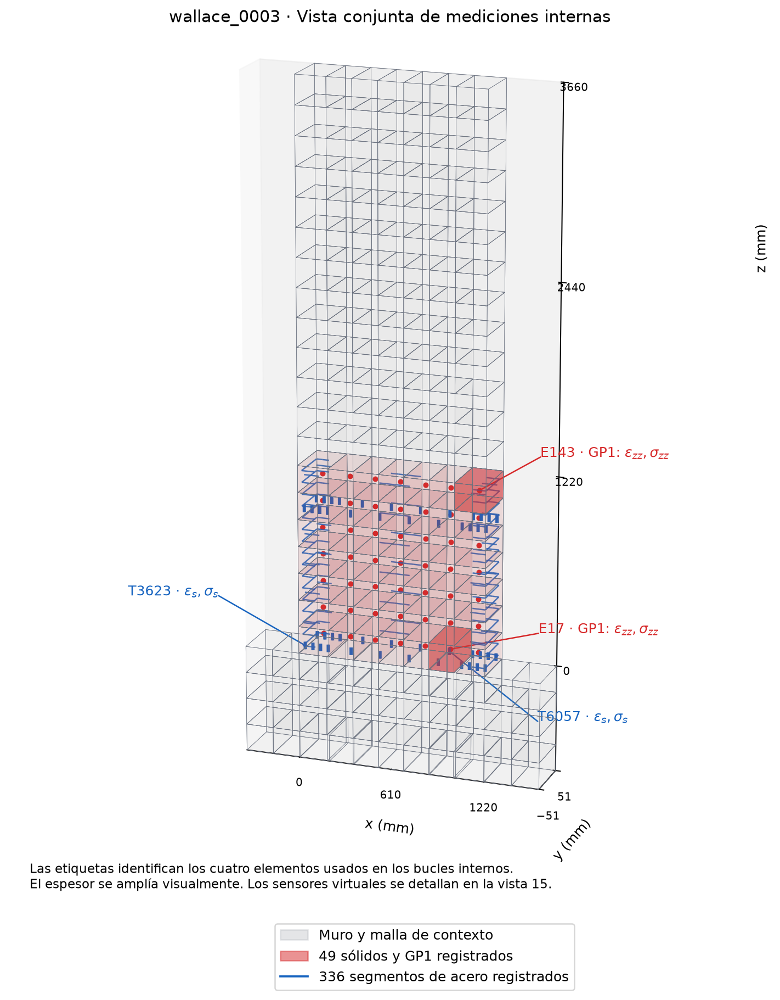
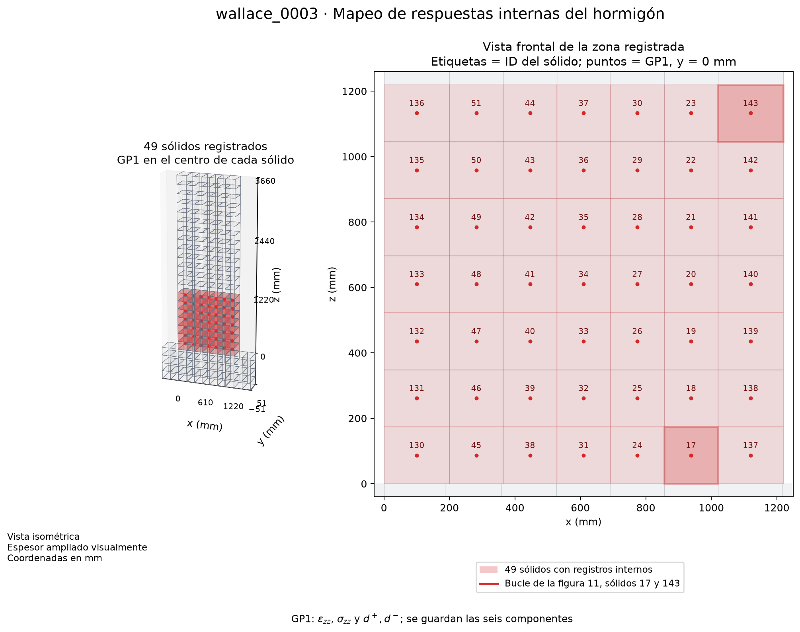
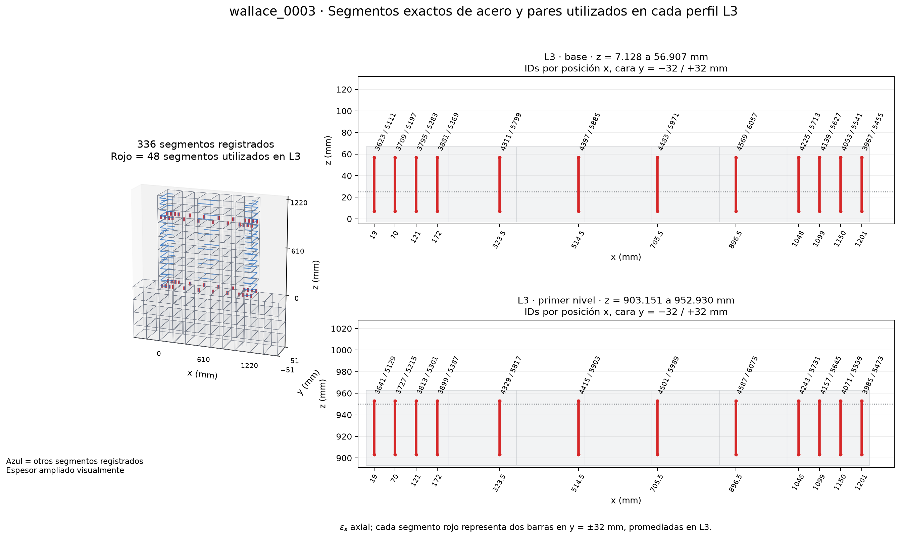
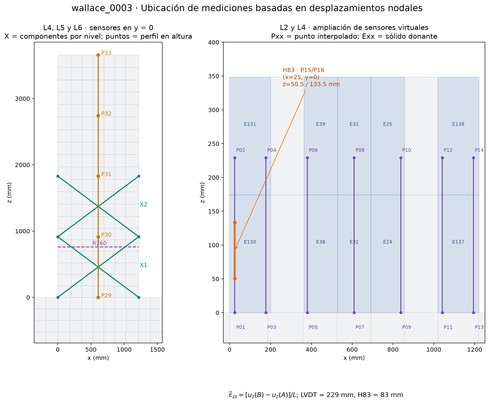
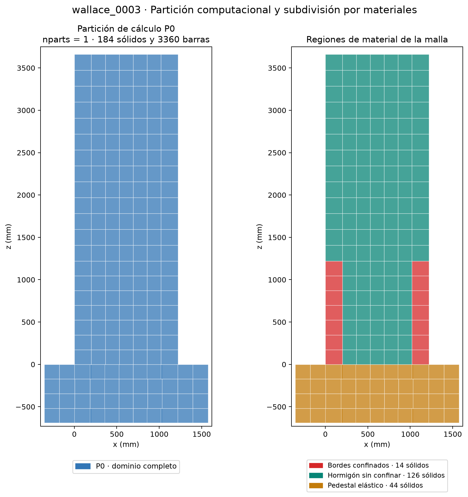

# Mapeo de respuestas locales de wallace_0003

El mapa corresponde al Tcl y los registradores archivados de esta corrida. Las coordenadas están en mm y representan la geometría inicial. x recorre la longitud de 0 a 1220, y el espesor de −51 a +51, y z la altura sobre la interfaz muro-pedestal. El pedestal ocupa z de −690 a 0. La configuración aplicada al último postproceso usa `strain_reference = after_gravity` y `profile_cycle = 1`.

## Vistas

Las vistas isométricas amplían visualmente el espesor para facilitar la lectura. Las coordenadas, los IDs y las vistas frontales se obtienen de la malla real. Las ampliaciones de sensores y segmentos emplean escalas horizontal y vertical distintas para mostrar sus extremos.

## Definición de las mediciones

| Curva o salida | Ubicación y soporte | Variable |
|---|---|---|
| L1 | Diagrama de ubicación | Posiciones de los sensores |
| L2, Fig. 7.30 | Siete pares de puntos en y=0, z=0 y 229 mm; x se lista abajo | Deformación vertical media, [uz(B)−uz(A)]/229; componente zz media en la longitud del sensor |
| L3, Fig. 7.31 | 24 segmentos verticales por nivel, dos caras en y=±32 mm, agrupados en 12 posiciones x | Deformación axial del material CorotTruss, promediada entre ambas caras para cada x |
| L4, Fig. 7.32 | H83, x=25, y=0, z=50.5 y 133.5 mm | Deformación vertical media, [uz(B)−uz(A)]/83 |
| L4, Fig. 7.29, rotación | Cuatro puntos R760, x=0/1220, y=0, z=0/760 mm | Diferencia de alargamientos de los bordes dividida por 1220, en rad |
| L4, Fig. 7.29, flexión | Cuatro esquinas X1 del primer nivel | Desplazamiento de flexión alfa·theta·h, con alfa=0.67 y h=914.5 |
| L5, Figs. 8.3 y 9.3 | Cuatro esquinas por nivel, X1 y X2 | Desplazamientos de corte/flexión y distorsión media; cálculo geométrico desde ux,uz |
| L6, Fig. 7.28 | Eje x=610, y=0, z=0/914.5/1829/2743.5/3660 | Desplazamiento horizontal de flexión tras descontar traslación de base y corte acumulado |
| L7, CSV internos | 49 sólidos con GP1 y 336 segmentos de acero | Tensores de tensión/deformación, daño d+,d− y tensión/deformación axial del acero |

### Puntos interpolados y nodos donantes

L2, H83 y las mediciones cinemáticas utilizan desplazamientos nodales interpolados con las ocho funciones de forma del hexaedro donante. Cada punto Pxx se identifica en la tabla. El CSV de nodos aporta los ocho IDs y sus pesos, incluyendo pesos cero, y las coordenadas nodales. En interfaces entre sólidos se reproduce la misma selección del postproceso mediante `RunResults.at`.

| point_id | sensor | x_mm | y_mm | z_mm | element_tag |
|---|---|---|---|---|---|
| P01 | LVDT1 | 25.4519 | 0 | 0 | 130 |
| P02 | LVDT1 | 25.4519 | 0 | 229 | 131 |
| P03 | LVDT2 | 177.801 | 0 | 0 | 130 |
| P04 | LVDT2 | 177.801 | 0 | 229 | 131 |
| P05 | LVDT3 | 381.054 | 0 | 0 | 38 |
| P06 | LVDT3 | 381.054 | 0 | 229 | 39 |
| P07 | LVDT4 | 609.638 | 0 | 0 | 31 |
| P08 | LVDT4 | 609.638 | 0 | 229 | 32 |
| P09 | LVDT5 | 838.222 | 0 | 0 | 24 |
| P10 | LVDT5 | 838.222 | 0 | 229 | 25 |
| P11 | LVDT6 | 1041.48 | 0 | 0 | 137 |
| P12 | LVDT6 | 1041.48 | 0 | 229 | 138 |
| P13 | LVDT7 | 1193.82 | 0 | 0 | 137 |
| P14 | LVDT7 | 1193.82 | 0 | 229 | 138 |
| P15 | H83 | 25 | 0 | 50.5 | 130 |
| P16 | H83 | 25 | 0 | 133.5 | 130 |
| P17 | R760 | 0 | 0 | 760 | 134 |
| P18 | R760 | 1220 | 0 | 760 | 141 |
| P19 | R760 | 0 | 0 | 0 | 130 |
| P20 | R760 | 1220 | 0 | 0 | 137 |
| P21 | X1 | 0 | 0 | 0 | 130 |
| P22 | X1 | 1220 | 0 | 0 | 137 |
| P23 | X1 | 0 | 0 | 914.5 | 135 |
| P24 | X1 | 1220 | 0 | 914.5 | 142 |
| P25 | X2 | 0 | 0 | 914.5 | 135 |
| P26 | X2 | 1220 | 0 | 914.5 | 142 |
| P27 | X2 | 0 | 0 | 1829 | 7 |
| P28 | X2 | 1220 | 0 | 1829 | 120 |
| P29 | PERFIL | 610 | 0 | 0 | 31 |
| P30 | PERFIL | 610 | 0 | 914.5 | 36 |
| P31 | PERFIL | 610 | 0 | 1829 | 81 |
| P32 | PERFIL | 610 | 0 | 2743.5 | 86 |
| P33 | PERFIL | 610 | 0 | 3660 | 90 |

[Puntos, elementos y pesos](datos/mapeo_puntos_virtuales.csv) · [Nodos donantes y pesos individuales](datos/mapeo_nodos_interpolacion.csv)

Para `after_gravity`, L2/L4/L5/L6 usan desplazamientos con el estado final de gravedad descontado. En L3 se descuenta la deformación de acero guardada en `baseline_steel.out`. Los registros internos crudos de L7 conservan la respuesta total del material. Los perfiles se muestrean en picos de deriva nominal positiva y en el primer ciclo del bloque elegido. El ciclo experimental permanece sin identificar en los CSV de referencia.

### L3 y longitud efectiva de cada segmento

Los segmentos de base abarcan z=7.127906977 a 56.906976744 mm, centro 32.017441860 mm. Los del primer nivel abarcan z=903.151162791 a 952.930232558 mm, centro 928.040697674 mm. Su longitud es 49.779069767 mm. La selección se hizo por contención de las alturas objetivo de 25 y 950 mm.

Cada respuesta `material stressStrain` corresponde al estado axial del segmento CorotTruss, uniforme en ese elemento de dos nodos. La extensión se evalúa a lo largo de su eje. En los segmentos verticales de L3 dicho eje coincide con z. El símbolo εs identifica la deformación uniaxial del acero. Para barras horizontales o estribos, el eje local sigue su dirección propia.

| level | x_mm | element_y_minus | element_y_plus |
|---|---|---|---|
| base | 19 | 3623 | 5111 |
| base | 70 | 3709 | 5197 |
| base | 121 | 3795 | 5283 |
| base | 172 | 3881 | 5369 |
| base | 323.5 | 4311 | 5799 |
| base | 514.5 | 4397 | 5885 |
| base | 705.5 | 4483 | 5971 |
| base | 896.5 | 4569 | 6057 |
| base | 1048 | 4225 | 5713 |
| base | 1099 | 4139 | 5627 |
| base | 1150 | 4053 | 5541 |
| base | 1201 | 3967 | 5455 |
| primer_nivel | 19 | 3641 | 5129 |
| primer_nivel | 70 | 3727 | 5215 |
| primer_nivel | 121 | 3813 | 5301 |
| primer_nivel | 172 | 3899 | 5387 |
| primer_nivel | 323.5 | 4329 | 5817 |
| primer_nivel | 514.5 | 4415 | 5903 |
| primer_nivel | 705.5 | 4501 | 5989 |
| primer_nivel | 896.5 | 4587 | 6075 |
| primer_nivel | 1048 | 4243 | 5731 |
| primer_nivel | 1099 | 4157 | 5645 |
| primer_nivel | 1150 | 4071 | 5559 |
| primer_nivel | 1201 | 3985 | 5473 |

[Todos los segmentos registrados, nodos, extremos, direcciones, sólidos anfitriones y columnas](datos/mapeo_segmentos_acero.csv) · [Pares promediados de L3](datos/mapeo_perfiles_L3.csv)

### L7 y componentes del hormigón

El Tcl usa `LadrunoBrick -formulation ssp`. Se registra `material 1 strain`, `material 1 stress` y `material 1 damage`. GP1 es el único punto constitutivo activo de SSP, asociado al centro del sólido. La deformación constitutiva SSP incluye su formulación estabilizada.

Los 49 centros están en y≈0. La zona registrada comprende todo el ancho del muro y los primeros 1220 mm de altura. El orden de deformación es εxx, εyy, εzz, γxy, γyz, γxz. Las componentes de corte se expresan como deformaciones ingenieriles. El orden de tensión es σxx, σyy, σzz, τxy, τyz, τxz, en MPa. Las deformaciones son adimensionales.

La figura `11_hormigon_tension_deformacion` utiliza εzz y σzz de los sólidos **17** y **143**. Sus centros son respectivamente **(938.0, 0.0, 87.142857)** y **(1120.0, 0.0, 1132.857143)** mm. La selección actual corresponde al primero y último del listado de registradores.

La figura `10_acero_tension_deformacion` utiliza los segmentos **3623** y **6057**, con centros **(19.0, -32.0, 32.017442)** y **(896.5, 32.0, 32.017442)** mm. También son el primero y último del listado filtrado por base.

La figura de daño utiliza el máximo espacial de d+ y d− entre los 49 sólidos en cada paso. El sólido que controla puede variar con el paso y entre tracción y compresión. El CSV siguiente identifica un sólido controlador por paso y componente; si hay empate devuelve el primero en el orden del registrador.

[Sólidos, GP1, nodos, límites y columnas](datos/mapeo_hormigon_gp1.csv) · [Controladores de los máximos de daño por paso](datos/mapeo_maximos_dano.csv)

Las columnas de los CSV de mapeo se numeran desde 1 y se refieren a los `.out`; la columna 1 es pseudotiempo. En el registro de hormigón, εzz/σzz ocupa la columna 4+6i y el daño las columnas 2+2i y 3+2i, para el índice i desde cero del sólido en el manifiesto. En el acero, tensión y deformación ocupan 2+2i y 3+2i.

## Partición y regiones

La corrida usa **nparts=1**, una sola partición de cálculo P0 y un archivo `.ladruno`. El dominio contiene 184 sólidos y 3360 elementos CorotTruss. Las tres zonas coloreadas de material comprenden 14 sólidos de hormigón confinado, 126 de hormigón sin confinar y 44 del pedestal elástico. La partición P0 incluye las tres zonas.

## Evidencia y alcance

- [Tcl de la corrida](rw2_solid_ladruno_embedment.tcl)
- [Manifiesto de registradores](registradores_locales.json)
- [Parámetros y configuración del postproceso](parametros.json)
- [Postproceso utilizado para reconstruir el mapa](../../rw2_workflow.py)
- [Fuente local de LadrunoBrick](D:/OneDrive/Documentos/GitHub/OpenSees/SRC/element/ladrunoBrick/LadrunoBrick.cpp), rutas SSP y respuestas del material.
- [Documentación oficial de SSPbrick](https://opensees.github.io/OpenSeesDocumentation/user/manual/model/elements/SSPbrick.html).
- [Respuestas de ASDConcrete3D](https://opensees.github.io/OpenSeesDocumentation/user/manual/material/ndMaterials/ASDConcrete3D.html).

Este informe describe las mediciones implementadas y los archivos archivados de wallace_0003. La función actual de L3 tiene pendiente inicializar `rows` antes de acumular resultados. Los perfiles de acero revisados corresponden a salidas guardadas previamente.

SHA256 del Tcl para identificar la malla descrita `2f0a6e25c26898e2ed4a0a57ce42c7bee06db7c9d4a20e58d010d3b4b303e26c`.
